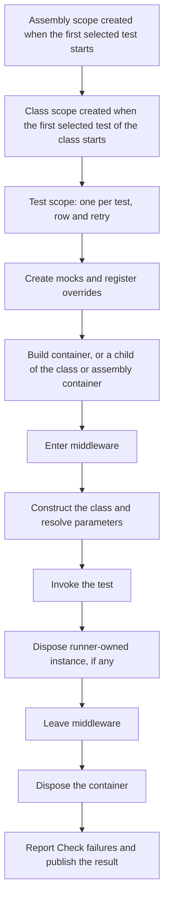

# VerificationGlue.Tests: a test framework on Microsoft.Testing.Platform

Status: design. Parent: `docs/north-star.md`. Research: `docs/research/design-report.md`, sections 1, 2 and 4.

## What the user gets

- A test project installs one package, `VerificationGlue.Tests`, and adds one line to `global.json`. `dotnet test` and `dotnet run` run its tests; support for discovery, navigation and debugging in Visual Studio, Rider and VS Code is gated on the pinned phase 0 results below.
- A method marked `[VerifyTest]` is a test. Eligible methods in a `partial` type chain get captured sub-expression values when tier 3 rewriting is enabled; otherwise they get tier 2 messages.
- Test parameters come from a DI container built for that test, with `[Mock]` parameters registered in the same container. The container is disposed as soon as the test ends, and disposal is awaited.
- Each data row gets its own container and its own result.
- Test IDs are stable across renames of display names, so retries, filters and IDE history keep working.
- Tests run in parallel by group, each group with its own limit, not at one assembly-wide level.
- The test project publishes with Native AOT and runs with no reflection.

```csharp
using static VerificationGlue.VerifySyntax;

[assembly: Container<ModuleBootstrap>]

[SutModule]
public partial class OrderTests
{
    [VerifyTest]
    [Row(2, 10)]
    [Row(3, 5)]
    public async Task Totals(int qty, int price, [Mock] IClock clock, OrderService sut)
    {
        clock.Now.Returns(new DateTime(2026, 11, 16));

        var order = await sut.CreateAsync(qty, price);

        Verify(order.Total == qty * price);
        Check(order.Created == clock.Now);
    }
}
```

The example uses a `partial` class so it is eligible for tier 3. Rewriting remains opt-in until the phase 0 gates in `verification-glue.md` pass; eligibility alone does not enable it. The [host and call-site capability matrix](verification-glue.md#host-and-call-site-capabilities) covers reflected tests, helpers and unsupported or disabled rewriting. Every advertised IDE must pass breakpoint binding and stepping, and the user must approve a total added cold-build budget at 100,000 calls that the benchmark then meets; the matched-baseline ratio is reported too. Missing budget approval is not a pass. Hot Reload limitations may be documented without blocking this gate.

## Package

`VerificationGlue.Tests` depends on exact versions of `VerificationGlue` and `VerificationGlue.Mocks`, and on `Microsoft.Testing.Platform`, `Microsoft.Testing.Platform.MSBuild` and `Microsoft.Testing.Extensions.TrxReport.Abstractions`. `Microsoft.Testing.Platform` has no dependencies of its own and is marked AOT compatible.

`build/VerificationGlue.Tests.props` sets:

- `OutputType=Exe` and `IsTestingPlatformApplication=true`.
- One `TestingPlatformBuilderHook` item, so the MTP MSBuild package generates an entry point that registers this framework.
- `InterceptorsNamespaces` for the generated code.

`build/VerificationGlue.Tests.targets` checks `global.json` for `"test": {"runner": "Microsoft.Testing.Platform"}` only when `dotnet test` runs in VSTest mode, in a target that runs before the `VSTest` target and before MTP's own `_MTPBeforeVSTest` check. When the setting is missing there, it fails with VGT1001 and prints the exact JSON to add. It never fails `dotnet build`, `dotnet run` or `dotnet publish`, which do not need the setting. A package cannot set this itself, because the `dotnet` CLI reads `global.json` before it evaluates any project. `dotnet run` on the test project works without it, because the project is an executable.

## Attributes

| Attribute | Placement | Meaning |
|---|---|---|
| `[VerifyTest]` | Method | A test. Carries `[VerifyRewrite]`, making eligible bodies candidates for rewriting when tier 3 is enabled. |
| `[Row(params object?[])]` | Method, many | One data row. Types are checked at compile time. |
| `[RowSource(nameof(Member))]` | Method | A static member returning rows. The call is generated and typed. |
| `[Container<T>] where T : ITestContainerBootstrap` | Assembly, class, method | The container for these tests. `Scope = Test` (default), `Class` or `Assembly`. |
| `[NameFormatter<T>] where T : ITestNameFormatter` | Assembly, class, method | Display names |
| `[Use<T>] where T : ITestMiddleware` | Assembly, class, method, many | Middleware around each test |
| `[ScheduleGroup(name, MaxParallel = n)]` | Assembly, class, method | Schedule group and its limit |
| `[Resource(key)]` | Class, method, many | Tests holding the same key never overlap |
| `[RunAfter(group)]` | Class | This class's group starts after the named group finishes |
| `[Scheduler<T>] where T : ITestScheduler` | Assembly | Replaces the scheduling policy |
| `[SessionSetup<T>] where T : ITestSessionSetup` | Assembly, many | Registers MTP extensions and options |
| `[Mock]` | Parameter | From `VerificationGlue.Mocks`. A generated mock, also registered in the container. |

Placement rules:

- Single-valued attributes resolve method first, then class, then assembly.
- Multi-valued attributes add up, widest first. DependencyModules uses the same rule today.
- Generic attributes give the generator the type as a type argument, so it calls the type's static members directly. An adapter can derive its own attribute, for example `ModuleTestAttribute : ContainerAttribute<ModuleBootstrap>`. That compiled in the research spike.

## Generated code

The generator emits one file per test class. Registration runs from a module initializer, so startup does no scanning.

```csharp
file static class OrderTests_Tests
{
    static Attribute[] CreateAttributes() => [new SutModuleAttribute()];
    static readonly TestParameter[] s_params = [ /* name, type, position, attributes */ ];

    [ModuleInitializer]
    internal static void Register()
    {
        TestRegistry.Add(new TestDescriptor(
            Uid: "MyApp.OrderTests.Totals(System.Int32,System.Int32,MyApp.IClock,MyApp.OrderService)#row(System.Int32:2,System.Int32:10)",
            Class: typeof(OrderTests),
            FilePath: "OrderTests.cs", Line: 9,
            CreateAttributes: static () => CreateAttributes(), Parameters: s_params,
            Group: ScheduleGroups.Default,
            DisplayName: static ctx => DefaultNameFormatter.Format(ctx),
            BuildContainer: static ctx => ModuleBootstrap.BuildAsync(ctx),
            Invoke: static async ctx =>
            {
                var clock = Mock.Of<IClock>();
                ctx.Override<IClock>(clock);
                await ctx.BuildContainerAsync();

                var instance = ctx.Resolve<OrderTests>() ?? new OrderTests();
                await instance.Totals__Verified(2, 10, clock, ctx.Resolve<OrderService>(s_params[3]));
            }));
        // ... the second row registers with #row(System.Int32:3,System.Int32:5)
    }
}
```

Points to note:

- Every attribute on the test method, its class and its assembly is materialised as a `new XAttribute(args)` expression, except attributes from `System` namespaces. The generator does not need to understand an attribute to pass it through. Extension points find the ones they care about with `OfType<T>()`, without reflection. An attribute is skipped and reported as VGT0006, with the reason, when the generated file cannot access it, such as an `internal` attribute from another assembly, when its arguments cannot be written as C#, or when another generator produces its type, which this generator cannot see.
- `Totals__Verified` is the rewritten copy from `VerificationGlue`. The generator calls it only when tier 3 is enabled and the shared `WillRewrite` function returns true; both generators use the same setting. Otherwise it calls `Totals` and the test gets tier 2 messages. See the contract in `docs/design/verification-glue.md`.
- `[Mock]` parameters become `Mock.Of<T>()` calls. The test generator never names a generated mock class, because it cannot see the mock generator's output.
- Mocks are registered as overrides before the container is built, so the system under test receives the same instance as the parameter. A `[Mock]` parameter that also carries `[FromKeyedServices(key)]` registers its mock under that key.
- `new OrderTests()` works here because `OrderTests` has no constructor parameters. A class with constructor parameters is built with each argument resolved in the order under "Parameters".

Attribute factories in the sketch are invoked lazily inside the owning test or scope failure boundary, never during module registration; parameter attributes follow the same rule. Constructor failures produce an attributed test or scope result and do not terminate discovery for unrelated tests. UID spelling above is illustrative; the canonical identity encoding is defined by the rules below.

## The MTP adapter

The runtime implements `ITestFramework` and `IDataProducer`:

- `CreateTestSessionAsync` reads the registry.
- `ExecuteRequestAsync` handles `DiscoverTestExecutionRequest` and `RunTestExecutionRequest`, honours `TestNodeUidListFilter`, publishes a `TestNodeUpdateMessage` per state change, and calls `context.Complete()`.
- `CloseTestSessionAsync` disposes the assembly scope.

Capabilities: `ITrxReportCapability`. Test nodes carry file and line through `TestFileLocationProperty` for IDE navigation. A class or assembly scope failure is published as a node with its own UID, and the affected tests name it as parent.

What MTP gives for free once UIDs are stable and the UID filter is honoured: `--list-tests`, `--filter-uid`, `--timeout`, `--results-directory`, `--minimum-expected-tests`, IDE server mode, and the Retry extension. TRX, HangDump, CrashDump and coverage are separate MTP extension packages a user can add.

Experimental MTP APIs marked `TPEXP`, such as `--treenode-filter` and graceful stop, are not used. Filtering by name, trait or group is a framework option, `--vg-filter`, so an MTP major cannot break it.

The research spike built this adapter by hand against MTP 2.5.3. `--list-tests` and `--filter-uid` worked, and a Native AOT publish produced a 10.9 MB binary with no warnings that ran two tests in 32 ms.

The MTP 2.5.3 result is historical evidence only, not validation of the shipping MTP 3 stack.

## Scopes

There are three levels: assembly, class and test. Each data row and each retry attempt is its own test scope.



Rules:

- A scope is created when its first selected test starts, so a filtered-out test builds nothing.
- A scope is disposed after its last test, in reverse creation order, with `await` inside `try/finally`.
- Every instance and acquired resource has exactly one disposal owner. The container disposes instances it creates; the runner disposes only instances it creates, including a test instance constructed directly. Externally supplied overrides retain an explicit owner unless ownership is transferred; registration alone must not create a second owner.
- Cleanup continues after any failure and awaits disposal of every successfully acquired resource in reverse ownership order, including cancellation or partial failure during setup. A failing cleanup operation must not prevent later cleanup.
- Preserve invocation, middleware-exit, instance-disposal, container-disposal and `Check` failures together in the final result. Keep the original failure and attach subsequent failures in occurrence order rather than replacing it with the last exception. A cleanup or `Check` failure makes an otherwise successful test fail. A class or assembly disposal failure fails that scope's node.
- Test output written at any point, including during container build, goes to that test's result. The test scope exists before the container does.
- The test scope opens a `VerifyScope`, so `Check` failures are collected and reported when the test ends.

## Containers

```csharp
public interface ITestContainerBootstrap
{
    static abstract ValueTask<ITestContainer> BuildAsync(TestContainerContext context);
}

public interface ITestContainer : IAsyncDisposable
{
    IServiceProvider Services { get; }
    bool TryResolve(TestParameter parameter, out object? value);
    ValueTask<ITestContainer> CreateChildAsync(TestContainerContext context);
}
```

`TestContainerContext` carries the test UID, the attributes in order, the parameters with their attributes, the overrides (mocks and anything middleware registered), each with its service type, instance and an optional service key, the parent container, the test output writer and a cancellation token.

The core depends only on `System.IServiceProvider`. A `[Container<T>(Scope = Class)]` builds one container per class and gives each test a child. A `[Container<T>(Scope = Assembly)]` builds one root container per assembly, for resources the whole run shares, and gives each class or test a child. It is created when the first selected test starts and disposed in `CloseTestSessionAsync`.

A child of a shared container, under `Scope = Class` or `Scope = Assembly`, can take per-test overrides only if its bootstrap supports that. `Microsoft.Extensions.DependencyInjection` cannot: `CreateScope()` adds no registrations, so a service resolved through the child keeps the shared container's registrations, not the test's mocks. A bootstrap declares the capability by implementing `ISupportsChildOverrides`. The generator reports VGT0008 when a test with `[Mock]` parameters or other overrides uses a shared container whose bootstrap does not implement it, and the runner checks again before invoking the test. The bootstraps built on MS.DI, including the DependencyModules one, do not declare it.

### DependencyModules adapter

The adapter ships from the DependencyModules repository as a package that depends on `VerificationGlue.Tests`:

```csharp
public sealed class ModuleBootstrap : ITestContainerBootstrap
{
    public static ValueTask<ITestContainer> BuildAsync(TestContainerContext c)
    {
        var services = new ServiceCollection();
        var modules = c.Attributes.OfType<IDependencyModuleProvider>().Select(p => p.GetModule());
        DependencyRegistry<object>.LoadModules(services, modules.Reverse().ToArray());
        foreach (var o in c.Overrides)
        {
            if (o.Key is null) services.AddSingleton(o.ServiceType, o.Instance);
            else services.AddKeyedSingleton(o.ServiceType, o.Key, o.Instance);
        }
        return new(new ServiceProviderContainer(services.BuildServiceProvider()));
    }
}
```

`[SutModule]` in the example is the application's own DependencyModules module, declared as `[DependencyModule] public partial class SutModule`. Placing it on a test class loads that module's registrations into the test's container.

A module declared in the test project itself gets its `{Name}Attribute` class from the DependencyModules generator, which this generator cannot see. VGT0006 reports it with that reason, and the adapter never loads it. Modules must come from referenced projects, and the adapter docs say so. Overrides are registered under their service key when they have one, so a keyed `[Mock]` reaches a service that injects that key.

DependencyModules work this needs:

- Variants of `ITestMethodContext` and `ITestParameterValueProvider` that take `TestParameter` and the attribute list instead of `MethodInfo` and `ParameterInfo`.
- `[TestExport]` ported onto the override list.
- `IMockSupportAttribute` for `VerificationGlue.Mocks`, so existing `DependencyModules.xUnit` tests can also use AOT mocks. Its package adds `DependencyModules.Testing.Attributes.MockAttribute` to the `VerificationGlueMockAttribute` MSBuild item from `buildTransitive`, so the mock generator generates mocks for DependencyModules' `[Mock]` parameters.

## Parameters

Each test parameter, and each constructor parameter of the test class, is resolved in this order:

1. The data row's value.
2. A parameter-level provider: `[Mock]`, which the generator turns into `Mock.Of<T>()`, or an attribute implementing `ITestParameterProvider`. `[Mock]` comes from `VerificationGlue.Mocks`, which has no dependencies, so it cannot implement that interface.
3. Method, class and assembly providers, narrowest first.
4. The container.
5. Built-ins: `CancellationToken`, `TestContext`, `ITestOutput`.
6. The parameter's default value.

Anything else fails the test, and the message names the parameter and the providers that were tried.

## Naming and identity

- The method identity uses the fully qualified containing type and parameter types, including generic and overload distinctions. It never depends on the display name.
- Literal `[Row]` identities are computed at compile time from canonical typed literal values, not source position, so inserting or reordering distinct rows preserves their UIDs. Identical duplicate literal rows use an occurrence suffix.
- Runtime row identities are completed at discovery. A row whose values are all primitives, strings or enums takes its identity from those values. Any other row uses `TestRow.Key`, a stable unique source key. The index is the last resort, and it is not stable across processes. An index identity is allowed only when the source explicitly guarantees deterministic replay of the same data at the same indices across discovery, execution and fresh-process retries; an unkeyed source without that contract fails discovery. A tuple-returning source whose values are not all primitives, strings or enums must make this replay guarantee or supply keyed rows through `ITestDataSource`.
- A duplicate compile-time UID is build error VGT0001. Duplicate runtime keys fail discovery with the source and key identified; they must never silently overwrite a test.
- The display name comes from `ITestNameFormatter`. The default is `Totals(qty: 2, price: 10)`.

## Data rows

- `[Row(...)]` emits one descriptor per row with literal arguments. A type mismatch is build error VGT0002.
- `[RowSource(nameof(X))]` emits a typed call to `X`, which returns `IEnumerable<(T1, T2, ...)>` or `IAsyncEnumerable<...>`. Rows are expanded at discovery and use the stable-key or explicit deterministic-replay identity contract above.
- Any attribute implementing `ITestDataSource` works the same way.
- A source that yields zero rows fails the test. It does not pass silently.

## Scheduling

Each test belongs to exactly one schedule group, assigned at compile time from `[ScheduleGroup]`, narrowest first. `[ScheduleGroup]` is single-valued at each level. A need that looks like a second group is expressed with `[Resource]`. Each group has its own concurrency limit, and groups run side by side.

```csharp
[assembly: ScheduleGroup("default", MaxParallel = 0)]   // 0 = processor count

[ScheduleGroup("database", MaxParallel = 2)]
public partial class OrderRepositoryTests { ... }

[ScheduleGroup("ui", MaxParallel = 1)]
public partial class CheckoutPageTests { ... }

[Resource("payments-sandbox")]
[VerifyTest] public async Task Refund(...) { ... }

[RunAfter("database")]
public partial class ReportTests { ... }
```

The default scheduler runs one queue per group with that group's limit. It holds a test until its resource keys are free, and starts a group after the groups it waits on. A cycle in `[RunAfter]` is build error VGT0003. Class scopes are created when the first test of the class starts, in whichever group it runs.

`ITestScheduler` replaces the whole policy, for example to run slow tests first, to shard across machines, or to read limits from configuration.

## Extension points

```csharp
interface ITestContainerBootstrap { static abstract ValueTask<ITestContainer> BuildAsync(TestContainerContext c); }
interface ITestParameterProvider  { bool TryProvide(TestContext c, TestParameter p, out object? value); }
interface ITestNameFormatter      { static abstract string Format(in TestNameContext c); }
interface ITestDataSource         { IAsyncEnumerable<TestRow> GetRowsAsync(TestDataContext c); }
interface ITestMiddleware         { ValueTask InvokeAsync(TestContext c, Func<ValueTask> next); }
interface ITestScopeListener      { ValueTask OnCreatedAsync(TestScope s); ValueTask OnDisposingAsync(TestScope s); }
interface ITestScheduler          { ValueTask RunAsync(IReadOnlyList<ScheduledTest> tests, Func<ScheduledTest, ValueTask> run, CancellationToken ct); }
interface ITestSessionSetup       { static abstract void Configure(ITestApplicationBuilder b, string[] args); }
```

Every interface is public and versioned with the package. A breaking change to any of them needs a major version.

## Pipeline and caching

- Discovery uses `ForAttributeWithMetadataName` on `[VerifyTest]`.
- `TestClassModel` holds the class's metadata name, its partial type chain, and an `EquatableArray<TestMethodModel>`. Each method model holds the signature as CSharpAuthor `ITypeDefinition` values, the materialised attributes as equatable `AttributeInstance` snapshots (type, constructor arguments, named arguments), the rows, the computed UIDs, the schedule group, `WillRewrite`, and diagnostics as plain values.
- Attributes are read with the CSharpAuthor Roslyn bridge, which provides those snapshots once required CSharpAuthor change 4 ships.
- One output file per test class. An edit to one class regenerates only that file.
- `KnownTypes` holds `static readonly` definitions for `TestRegistry`, `TestDescriptor`, `TestParameter`, `Mock`, `ModuleInitializerAttribute` and the rest.

## Analyzers and build checks

| ID | Severity | Reports |
|---|---|---|
| VGT0001 | Error | Duplicate test UID |
| VGT0002 | Error | A `[Row]` value that does not match its parameter type |
| VGT0003 | Error | A cycle in `[RunAfter]` |
| VGT0004 | Warning | A `[VerifyTest]` method that is not public, or is generic with no rows to close it |
| VGT0005 | Error | A `[RowSource]` member that is missing or returns the wrong shape |
| VGT0006 | Warning | An attribute that cannot be materialised, so extension points will not see it, with the reason |
| VGT0007 | Error | The referenced `VerificationGlue` has a different version from `VerificationGlue.Tests` |
| VGT0008 | Error | A test with `[Mock]` parameters or other overrides under a shared container whose bootstrap does not implement `ISupportsChildOverrides` |
| VGT1001 | Error, under `dotnet test` only | `global.json` lacks the MTP test runner setting |

## Versioning

- Each MTP major gets a VerificationGlue major. The previous major stays on a `release/N.x` branch that receives fixes.
- MTP 3 drops the net8 and net9 assets. VerificationGlue targets net10 only.
- `VerificationGlue.Tests` builds against the MTP 3 previews from Phase 1. Its first public release is 1.0.0, and 1.0.0 of all three packages ships only after MTP 3 is stable. Until then `VerificationGlue.Tests` ships previews only.
- `VerificationGlue`, `VerificationGlue.Mocks` and `VerificationGlue.Tests` share one version number, because the test generator depends on the `WillRewrite` contract and on `Mock.Of<T>()`.
- One version number alone does not stop a restore from pairing different versions. `VerificationGlue.Tests` therefore depends on exact versions of the other two, and VGT0007 reports a referenced `VerificationGlue` of a different version.
- A major caused by MTP does not break the public surface of `VerificationGlue` or `VerificationGlue.Mocks`. The north star states the rule and the CI check.

## Documentation

This package owns these pages. The rules for producing and checking them are in the north star.

- README and `docs/guide/getting-started-tests.md`, including the `global.json` line and the IDE setup for Visual Studio, Rider and VS Code.
- Guides: "Containers and scopes", "Parameters and where they come from", "Data rows", "Scheduling groups and resources", "Running under Native AOT", "CI setup with TRX and retries".
- `docs/guide/extending.md`, covering every extension interface, with the DependencyModules adapter as the worked example.
- Migration guides from xunit, NUnit and `DependencyModules.xUnit`, as paired samples that both compile. The xunit guide ships with the first release. The `DependencyModules.xUnit` guide ships with Phase 4. The NUnit guide follows the first release.
- `docs/diagnostics/VGT0001.md` to `VGT0008.md` and `VGT1001.md`.
- A generated-code page showing a test class's registration file.
- A lifecycle page built around the scope diagram, with a sample that logs every step.

## Delivery

Phases 1 and 2 ship as previews. Phases 1 to 3 together are the first public release, 1.0.0. Phase 4 follows it. The release map for all three packages is in the north star.

### Phase 0: IDE discovery spike

When done, we know that a generated MTP framework shows tests with source navigation in Visual Studio, Rider and VS Code.

Needs: the runner spike committed under `spikes/`, which is the first action of "Repository foundation" in the north star. It shares its IDE setup with the debugging spike in `verification-glue.md` Phase 0.

- [ ] Write down the fallback for each IDE before the spike runs: what the docs promise for that IDE if discovery, run, debug or navigation fails there.
- [ ] Run the adapter on MTP 2.5.3 as well as on the current MTP 3 preview, so a failure can be attributed to the preview or to a generated framework.
- [ ] Run the adapter on pinned .NET 10 SDK, MTP 3, IDE and IDE-plugin versions; record discovery, UID-filtered execution, navigation and debugging per IDE in `docs/research/ide-report.md`, alongside the assertion debugging spike.
- [ ] Publish and execute the same stack under Native AOT with no trim or AOT warnings.
- [ ] Record supported limitations and fallback behavior in that report before making release promises; MTP 2.5.3 results are historical comparison only.
- [ ] Keep tier 3 opt-in until every advertised IDE passes breakpoint binding and stepping and the separately user-approved total added cold-build budget passes at 100,000 calls, with the matched-baseline ratio reported; missing approval is not a pass and Hot Reload limitations alone do not block the gate.

### Phase 1: run tests

When done, a user marks methods `[VerifyTest]`, runs `dotnet test`, filters by UID, gets TRX, and publishes the test project with Native AOT.

Needs: Phase 0, and "Repository foundation" in the north star. The calls to `__Verified` need `verification-glue.md` Phase 2, which holds the tier 3 rewrite and `WillRewrite`.

- [ ] Runtime adapter for discovery and execution, built against the current MTP 3 preview.
- [ ] Generator for registration, UIDs and attribute materialisation, built on CSharpAuthor.
- [ ] The props and targets, including VGT1001, with acceptance cases: build, run and AOT publish succeed without the `global.json` setting, and `dotnet test` without it prints the guidance on the chosen MTP stack.
- [ ] Exact-version dependencies on `VerificationGlue` and `VerificationGlue.Mocks`, and VGT0007.
- [ ] Calls to `__Verified` through `WillRewrite`.
- [ ] Analyzers VGT0001 and VGT0004.
- [ ] A Native AOT test project in CI, with startup time recorded.
- [ ] Pages: README, `docs/guide/getting-started-tests.md`, the guide "Running under Native AOT", `docs/diagnostics/VGT0001.md`, `VGT0004.md`, `VGT0006.md`, `VGT0007.md` and `VGT1001.md`, and the generated-code page.

### Phase 2: scopes and containers

When done, tests take services and mocks as parameters from a per-test container that is disposed when the test ends.

Needs: Phase 1. `Check` failures need `Check` and `VerifyScope` from `verification-glue.md` Phase 2. `[Mock]` parameters need `Mock.Of<T>()` from `mocks.md` Phase 1.

- [ ] Assembly, class and test scopes with the order above.
- [ ] `ITestContainerBootstrap`, `ITestContainer`, `[Container<T>]` with test, class and assembly scope.
- [ ] `ISupportsChildOverrides`, VGT0008, and the same check before each test is invoked.
- [ ] Parameter resolution order and its failure message.
- [ ] `[Mock]` parameters through `Mock.Of<T>()` and overrides.
- [ ] Middleware, scope listeners and test output during container build.
- [ ] `Check` failures reported per test.
- [ ] Lifecycle acceptance cases: exactly-once disposal for container-owned and runner-owned instances; cancellation during setup; invocation plus multiple cleanup and `Check` failures with all failures retained; lazy attribute-construction failure attributed to its owner while unrelated tests run; fresh per-attempt state and cleanup on retries.
- [ ] Pages: the guides "Containers and scopes" and "Parameters and where they come from", the lifecycle page, `docs/diagnostics/VGT0008.md`, and the sections of `docs/guide/extending.md` for containers, parameter providers, middleware and scope listeners.

### Phase 3: data, naming and scheduling

When done, data-driven tests get a result and a container per row, names are pluggable, and tests are scheduled by group.

Needs: Phase 2. Nothing new from the other packages.

- [ ] `[Row]`, `[RowSource]`, `ITestDataSource`, and analyzers VGT0002 and VGT0005.
- [ ] `ITestNameFormatter` and the default format.
- [ ] Schedule groups, resources, `[RunAfter]`, VGT0003 and `ITestScheduler`.
- [ ] `--vg-filter`.
- [ ] Gate data-row UID filtering and fresh-process retry support on cases for inserted/reordered literal rows, reordered keyed runtime sources, reordered sources of primitive values, throwing and empty sources, duplicate runtime keys, and explicit deterministic index replay; each retry must execute the intended row and invalid sources must fail rather than select different data.
- [ ] Pages: the guides "Data rows", "Scheduling groups and resources" and "CI setup with TRX and retries", `docs/diagnostics/VGT0002.md`, `VGT0003.md` and `VGT0005.md`, the sections of `docs/guide/extending.md` for data sources, name formatters and schedulers, the migration guide from xunit, and `llms.txt`.

### Phase 4: DependencyModules

When done, a DependencyModules user moves a test from `[ModuleTest]` on xunit to `[VerifyTest]` by changing the attribute and the package.

Needs: Phase 2, `mocks.md` Phase 1, and the DependencyModules work listed under "DependencyModules adapter", which is done in the DependencyModules repository.

- [ ] The adapter package in the DependencyModules repository.
- [ ] Reflection-free variants of the DependencyModules test interfaces.
- [ ] `[TestExport]` and `IMockSupportAttribute`.
- [ ] A paired sample in which a keyed `[Mock]` reaches the system under test.
- [ ] Pages: the migration guide from `DependencyModules.xUnit`, and the adapter as the worked example in `docs/guide/extending.md`.

## Risks and open questions

- MTP has shipped a breaking major about once a year. The narrow surface and the release branches limit the cost.
- IDE support for a new MTP framework is untested. Phase 0 answers this.
- Generic test methods and classes, `[RowSource]` returning `object[]`, and containers that use reflection limit what Native AOT can do. Microsoft.Extensions.DependencyInjection works under AOT but is not reflection-free.
- F# and VB get no generator, so they cannot use `VerificationGlue.Tests`.
- Attribute constructors can have side effects or throw. Materialise them lazily inside their owning test or scope failure boundary and retain those failures in the result; never run user attribute constructors in module registration.
