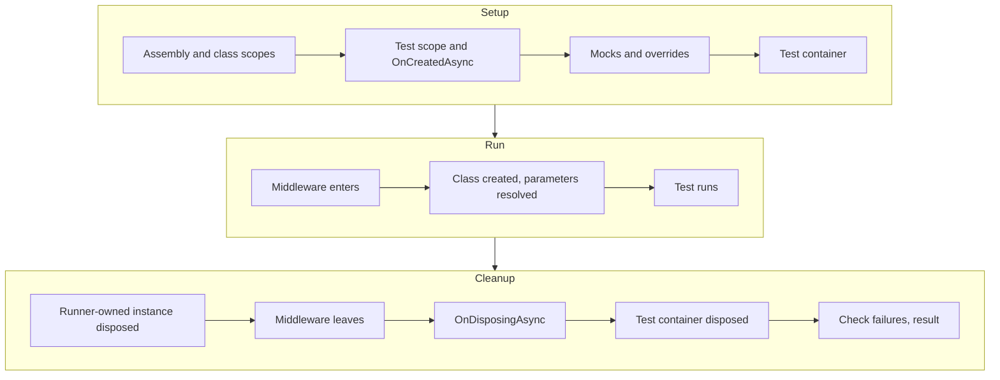

# Test lifecycle

At the end of this page you know when the runner creates and disposes each scope, container and test class, and how it reports a test that fails more than once.

## Scopes

There are three scope levels: the assembly, each test class, and each test. A scope is created when its first selected test starts, so a test that a filter leaves out creates nothing. A scope is disposed after its last selected test, and the assembly scope is disposed last.

Tests run at the same time, as [Scheduling groups and resources](scheduling-groups-and-resources.md) describes. When two tests of one class start together, the first one creates the class scope and the other waits for it, whichever schedule group each test is in. The class scope is still disposed once, after the last of its tests ends.

Each test runs these steps in order:



## A sample that logs every step

`samples/TestsLifecycle` has an assembly-level [scope listener](extending.md#scope-listeners), [middleware](extending.md#middleware), a class container whose children log what they do, and a test class that logs when it is created and disposed:

<!-- snippet: tests-lifecycle-sample -->
<a id='snippet-tests-lifecycle-sample'></a>
```cs
[Container<LoggingBootstrap>(Scope = ContainerScope.Class)]
[Use<LogMiddleware>]
public sealed partial class LifecycleTests : IAsyncDisposable
{
    public LifecycleTests() => Steps.Write("test class created");

    [VerifyTest]
    public void First([Mock] IClock clock, Basket basket)
    {
        Steps.Write("first test runs");
        Check(ReferenceEquals(basket.Clock, clock));
    }

    [VerifyTest]
    public void Second([Mock] IClock clock, Basket basket)
    {
        Steps.Write("second test runs");
        Check(ReferenceEquals(basket.Clock, clock));
    }

    public ValueTask DisposeAsync()
    {
        Steps.Write("test class disposed");
        return default;
    }
}
```
<sup><a href='/samples/TestsLifecycle/LifecycleTests.cs#L110-L137' title='Snippet source file'>snippet source</a> | <a href='#snippet-tests-lifecycle-sample' title='Start of snippet'>anchor</a></sup>
<!-- endSnippet -->

The sample also sets `[assembly: ScheduleGroup("default", MaxParallel = 1)]`, so its two tests run one after the other and their steps do not mix in the log. Running it writes these steps to `lifecycle.log`:

<!-- snippet: LifecycleSampleSpecs.Logs_every_step.verified.txt -->
<a id='snippet-LifecycleSampleSpecs.Logs_every_step.verified.txt'></a>
```txt
assembly scope created
class scope LifecycleTests created
test scope First created
class container built
test container built with overrides for IClock
middleware entered
test class created
parameter basket resolved from the test container
first test runs
test class disposed
middleware left
test scope First disposing
test container disposed
test scope Second created
test container built with overrides for IClock
middleware entered
test class created
parameter basket resolved from the test container
second test runs
test class disposed
middleware left
test scope Second disposing
test container disposed
class scope LifecycleTests disposing
class container disposed
assembly scope disposing
```
<sup><a href='/test/VerificationGlue.Tests.Specs/Snapshots/LifecycleSampleSpecs.Logs_every_step.verified.txt#L1-L26' title='Snippet source file'>snippet source</a> | <a href='#snippet-LifecycleSampleSpecs.Logs_every_step.verified.txt' title='Start of snippet'>anchor</a></sup>
<!-- endSnippet -->

The log shows these rules:

- The class container is built while the first test is set up, after that test's scope is created. The second test reuses it.
- Each test gets its own child container with its own `IClock` mock.
- The runner creates the test class inside the middleware and disposes it before the middleware leaves.
- The class scope and its container are disposed after the class's last test. The assembly scope is disposed after the last test of the run.

`test/VerificationGlue.Tests.Specs/LifecycleSampleSpecs.cs` runs the sample and fails when its log differs from the steps above.

## Who disposes what

Each instance has one owner, and only that owner disposes it:

- A container disposes the instances it creates.
- The runner disposes a test class instance it created. A test class that the container returns belongs to the container.
- An override, such as a `[Mock]` parameter's mock, belongs to whoever added it. The container returns it and does not dispose it.

Cleanup always runs every step. When one step fails, the next step still runs.

## A test with more than one failure

The runner keeps every failure of a test, in the order they happened. The result's message starts with the first failure and lists the rest after it. A test whose body throws, whose instance fails to dispose, whose middleware fails on leaving, whose container fails to dispose and which has a failed `Check` reports:

```text
The test threw after a failed check.

4 more failures after it:

InvalidOperationException: The test instance failed to dispose.

InvalidOperationException: The middleware failed on leaving.

InvalidOperationException: The container failed to dispose.

VerifyException: 1 check failed

Check failed: total == 3
  total → 2
```

The fixture class in `test/VerificationGlue.Tests.Fixture/ScopeTests.cs`, `MultipleFailuresTests`, produces this message with tier 3 rewriting on.

A failed `Check` or a cleanup failure fails a test that otherwise passed. `Check` failures are collected in a `VerifyScope` that the test scope opens, so they are reported with the test that made them and never with the next test.

A class or assembly scope that fails to dispose is reported as a failed node of its own, such as `Shop.OrderTests#class-scope`.

## Failures outside the test

- An attribute constructor that throws fails only the scope that owns it. A failing class attribute fails every test of that class with `The class scope Shop.OrderTests could not be created:` and the attribute's message. Tests in other classes still run.
- A class or assembly container that fails to build fails each test that uses it, with the scope named in the message. The runner does not try to build it again.
- When the run is cancelled during setup, such as by `--timeout`, the runner disposes what setup created, including the test scope's listeners and the class container, and starts no more tests.
- A cancelled run is reported as aborted with exit code 3. MTP drops the results that arrive after the cancellation, so a test or scope that fails after it, such as in cleanup, is not in the TRX file or the summary's counts. The runner writes those failures to the console output instead, under the test or scope they belong to and in the order they happened. Each failure's stack trace follows its type and message:

  ```text
  Shop.OrderTests.Ships(Shop.Order) failed after the run was cancelled. The test run summary does not count this failure.
    OperationCanceledException: The operation was canceled.
     at Shop.OrderTests.Ships(Order order) in OrderTests.cs:line 42
    InvalidOperationException: The connection is already closed.
     at Shop.Database.Dispose() in Database.cs:line 17
  ```

## Retries

Each attempt of the [MTP Retry extension](https://learn.microsoft.com/dotnet/core/testing/microsoft-testing-platform-retry) runs in a new process. A retried test gets new static state, new scopes and a new container, and each attempt disposes its own.

`test/VerificationGlue.Tests.Specs/LifecycleSpecs.cs` checks each rule on this page against `test/VerificationGlue.Tests.Fixture`.

## Next

- [Containers and scopes](containers-and-scopes.md)
- [Parameters and where they come from](test-parameters.md)
- [Scheduling groups and resources](scheduling-groups-and-resources.md)
- [Extending VerificationGlue.Tests](extending.md)
