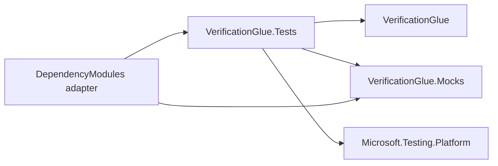

# VerificationGlue north star

VerificationGlue is a set of three .NET packages for writing tests that build with source generation and run under Native AOT. When it is done, a developer can do the following.

- Write `Verify(order.Total == 20)` and, when it fails, read every sub-expression's value in the message with no hand-written text.
- Write `[Mock] IClock clock` and get a mock that works under Native AOT, with NSubstitute-style setup such as `clock.Now.Returns(date)`.
- Mark a method `[VerifyTest]`, take services and mocks as parameters, and get a fresh DI container per test that is disposed when that test ends.
- Install one package per need, in any combination, and upgrade without the breaking changes that come with each new major version of a test framework.

The three packages ship from this repository with one version number.

## The problems

Each problem below is one the author has hit while extending xunit, NUnit and MSTest. The file references are to the author's own repositories. The research behind them is in `docs/research/design-report.md`.

1. **Extensibility points are painful or missing.** DependencyModules has to implement `ISelfExecutingXunitTestCase` and call a 13-parameter base constructor with named arguments because the parameter list shifts between versions (`DependencyModules/src/DependencyModules.xUnit/Impl/ModuleTestCase.cs`).
2. **Scopes are created and disposed at the wrong time.** xUnit disposes a test case only after the whole assembly has run. Containers are built before `TestContext.Current.Test` exists, so output written during container build is lost (`Impl/XunitCurrentTestProvider.cs`).
3. **The framework decides how a test is named.** Names and IDs must come from `TestIntrospectionHelper.GetTestCaseDetails`, and a colliding ID drops the test silently (`Impl/ModuleTestDiscoverer.cs`).
4. **The frameworks resist extension.** A custom discoverer must back-fill `ITypeAwareDataAttribute.MemberType`, or `[MemberData]` yields zero rows and the run passes (`ModuleTestCase.SupplyReflectedType`).
5. **Too many packages.** A test project references `Microsoft.NET.Test.Sdk`, `xunit.runner.visualstudio`, `xunit.v3`, `coverlet.collector` and an extension package. Hardened needs warning `HRDT001` because `[ModuleTest]` lives in one of three runner packages.
6. **Frequent breaking changes.** xunit.v3 4.0 changed `ISelfExecutingXunitTestCase.Run`, so DependencyModules ships `DependencyModules.xUnit` and `DependencyModules.xUnit4` from one source tree under `#if XUNIT_V4`.
7. **Tests are not container aware.** Services cannot be test parameters without framework-specific glue, and NUnit's synchronous pipeline forces `ResolveArgumentsAsync(...).GetAwaiter().GetResult()`.
8. **They are slow and reflection-bound.** Discovery, attribute lookup and data sources use reflection. Mocking libraries use Reflection.Emit, which does not work under Native AOT.
9. **Assertion messages are poor or hand-written.** `Assert.True(x)` reports `False`. Libraries that print the source text read source files at run time, which fails under AOT.

## What we are building

| Package | Purpose | Depends on | Design |
|---|---|---|---|
| `VerificationGlue` | `Verify` and `Check` syntax, and the generator that turns a boolean expression into a failure message with values | nothing | `docs/design/verification-glue.md` |
| `VerificationGlue.Mocks` | Source-generated mocks with NSubstitute-style setup. Works in any test framework. | nothing | `docs/design/mocks.md` |
| `VerificationGlue.Tests` | A test framework on Microsoft.Testing.Platform (MTP): `[VerifyTest]`, per-test DI containers, `[Mock]` parameters, scheduling | `VerificationGlue`, `VerificationGlue.Mocks`, MTP | `docs/design/tests.md` |

`VerificationGlue` and `VerificationGlue.Mocks` are useful on their own. A team on xunit can add either one without changing test framework. `VerificationGlue.Tests` is the full experience and brings both with it.



Each package carries its own runtime library and its own generator in `analyzers/dotnet/cs`. Generated code calls the runtime directly, so the runtime and the generator in one package always match in version.

## Principles

1. **No reflection at run time.** Discovery, attribute reading, data rows, parameter resolution and mock creation are all generated code. Every package passes a Native AOT publish with no trim or AOT warnings in CI.
2. **Every extension point is a public interface with a static or instance method the generator calls directly.** Generic attributes such as `[Container<T>]` name the type, so nothing is created through `Activator`.
3. **One package per need.** A user installs `VerificationGlue.Tests` and edits `global.json` once. Nothing else is required.
4. **Scopes are explicit.** Every container, test instance and fixture has a defined creation point and disposal point, and disposal is awaited.
5. **Test identity is ours.** A test's UID is computed at compile time from its symbol and data row. The display name is a separate, pluggable piece.
6. **Builds must be fast cold, not only warm.** Agents and CI clone a repository, build once and push. The target scale is 10,000 tests averaging 10 `Verify` calls each, across a few assemblies. Every generator has a cold-build benchmark in CI.
7. **Misuse fails at build time.** Each package ships analyzers with its generator. A construct the generator cannot handle produces a diagnostic, never a silent fallback.

## Decisions taken

- Target net10 only, so the test framework can follow MTP 3.
- Each MTP major version gets a VerificationGlue major version. The previous major stays on a release branch that receives fixes.
- `Verify(cond)` throws at once. `Check(cond)` records a failure and lets the test continue. The test then fails at the end with every recorded failure listed.
- `.WithMessage` and `.Because` outside a `[Verify]` method are build errors.
- Mock setup uses NSubstitute-style syntax. Each mock has its own `MockAdapter` instance.
- Mocks also get a generated, typed setup surface that needs no thread-static state.
- Recursive mocks are in the first mock release. Class mocks call the base member by default.
- There is no `Note(expr)`.
- The test generator materialises every attribute on a test that is not from `System`, so extension points receive them without the generator understanding them.
- A test belongs to exactly one schedule group.
- The namespace matches the repository name: `VerificationGlue`.
- All generated code is written with CSharpAuthor. See the next section.

## Code generation with CSharpAuthor

All three generators build their output with CSharpAuthor 2.x. CSharpAuthor ships as source, so it compiles into each generator assembly and adds no package dependency. Each generator project references it with `PrivateAssets=all`, `IncludeAssets=build` and `PackageCSharpAuthorIncludeRoslyn=true`. The Roslyn bridge turns an `ITypeSymbol` into an `ITypeDefinition` and reads attributes.

The rules below decide what may be cached, where, and for how long. They were taken from reading the CSharpAuthor source at tag 2.0.0. Claims marked [I] are inference and are checked by the generator benchmark.

### What goes into an incremental pipeline model

An incremental generator reruns a stage only when its input model compares unequal. A model that compares by reference never hits the cache and makes the IDE slow without failing anything.

| CSharpAuthor type | In a model? | Why |
|---|---|---|
| `ITypeDefinition` (from `TypeDefinition.Get`, `GetTypeDefinition(ITypeSymbol)`, generic, array, tuple and nested forms) | Yes | Value equality and a stable hash. `CompareTo` gives a stable order, which keeps output byte-identical. |
| `TypeParameterDefinition` | Yes | Value equality, documented for this purpose. |
| `EquatableArray<T>` (`CSharpAuthor.Collections`) | Yes, for every collection member | Element-wise equality. `T[]`, `List<T>` and `ImmutableArray<T>` compare by reference inside a record. |
| `AttributeInstance` (Roslyn bridge) | No | A sealed class with no value equality. Read it in the transform and copy what the emitter needs into our own records. |
| `Ex`, `Pat`, `Raw` | No | Each holds a write delegate, so equality is by reference. |
| `CSharpFileDefinition`, `ClassDefinition`, `MethodDefinition` and other builders | No | Mutable. Build them in the output step only. |
| `EmitProfile` | No | Mutable unless frozen, with no value equality. See below. |
| `ISymbol`, `SyntaxNode`, `Location`, `Compilation` | No | Roslyn rule. They pin the whole compilation in memory. |

A file path and span for a diagnostic travel as strings and integers, not as a `Location`.

### What can be built once and shared

- **Type definitions for our own runtime types.** A generator does not reference the runtime assembly, so it names those types by namespace and name. Each generator keeps one `static readonly` class of them, for example `KnownTypes.MockAdapter`. `TypeDefinition.Get(Type)` allocates a new definition on every call except for built-in types, so BCL types used often, such as `Task<T>` or `CancellationToken`, are cached the same way.
- **Constant expressions.** `Ex` is a sealed class whose only state is a `readonly` write delegate, so a constant node such as `Ex.Id("_adapter")` or a `Pat.NotNull()` can live in a `static readonly` field and be written into any number of files. [I] Sharing across threads is safe as long as the delegate captures only immutable values. A unit test pins this.
- **The emit profile.** Build it once per compilation with `EmitProfileRoslynExtensions.ForGeneration` from `AnalyzerConfigOptionsProvider` and `ParseOptions`, then call `Freeze()`. Because `EmitProfile` has no value equality, the pipeline carries an equatable `EmitSettings` record (language version and the editorconfig values the profile reads). The output step turns that record into a frozen profile through a small cache keyed by the record.

### What is per file

- One `CSharpFileDefinition` and one `OutputContext` per generated file. `OutputContext` allocates its `StringBuilder` lazily and has no reset method, so it is not pooled.
- `TypeOutputMode.Global` for every file. CSharpAuthor recommends it for generators. It qualifies every type with `global::`, derives no `using` directives, and is the faster path.
- `AddAutoGeneratedHeader` on every file.

### What the generators need that CSharpAuthor already has

- `LineDirectiveComponent.At(line, file)` for the `#line` mapping in rewritten `Verify` methods.
- `PragmaOutputComponent` to silence warnings in copied method bodies.
- `Raw`, which holds a fragment of user code as one node and still writes its types through the output context. The `Verify` rewrite copies statements that contain no `Verify` call as `Raw` nodes.
- `Ex` and `Pat` for every expression and pattern the generators build, including the rewritten conditions and the property-pattern explanations.

### Required changes to CSharpAuthor

These four changes ship in a CSharpAuthor minor release before generator work starts. The rules above describe CSharpAuthor 2.0.0. Once the changes land, the generators use them and drop the workarounds.

1. **`OutputContext.Reset()`.** It clears the output and the derived type references and keeps the buffer, so a generator reuses one context for many small files such as interceptors. Replaces one context per file.
2. **A cache for `TypeDefinition.Get(Type)`, keyed by `Type`.** It must be thread-safe, because Roslyn runs generators in parallel. Replaces our own cache of BCL types. Our `KnownTypes` for runtime types stay, because those are named by string.
3. **Value equality on `EmitProfile`**, over every setting that changes output. A frozen profile can then flow through a pipeline. Replaces the `EmitSettings` record and its cache.
4. **An equatable snapshot of `AttributeInstance`**, holding the attribute type as `ITypeDefinition` and its arguments as values. Attribute reads can then flow through a pipeline. Replaces the copy into our own records.

## Repository layout

```
src/
  VerificationGlue/                    runtime: VerifySyntax, VerifyException, formatters
  VerificationGlue.Generator/          Verify rewrite, interceptors, analyzers
  VerificationGlue.Mocks/              runtime: MockAdapter, Arg, Returns, Received, MockRegistry
  VerificationGlue.Mocks.Generator/    mock classes, registry, Arg interceptors, analyzers
  VerificationGlue.Tests/              runtime: MTP adapter, scopes, scheduler, extension interfaces
  VerificationGlue.Tests.Generator/    test discovery and registration, analyzers
  Shared.Generator/                    source shared by the three generators: models, KnownTypes base, WillRewrite
test/
  ...                                  one test project per source project, plus the conformance, benchmark and docs suites
samples/
  ...                                  compiled sample projects; every code block in the docs comes from here
docs/
  north-star.md
  guide/                               user documentation, see "Documentation" below
  diagnostics/                         one page per diagnostic ID
  design/
  research/
```

The package `VerificationGlue.Tests` takes the name a test project would normally use. This repository's own test projects therefore live under `test/` and end in `.Specs`, for example `VerificationGlue.Mocks.Specs`.

## Documentation

When this is done, a developer, or an AI agent writing code for one, can learn each package from its docs alone. Every example in the docs compiles and runs. Every failure message shown is the real output of the current build. Every diagnostic links to a page that explains it and shows the fix. A pull request that changes behaviour without changing the docs fails CI.

The rule behind this: **documentation is built from the product, not written beside it.** Anything that can be generated or checked is generated or checked. People write only the explanation.

### What we publish

| Kind | Where | Audience | Source of truth |
|---|---|---|---|
| Package README | Each package's NuGet page and `src/*/README.md` | Someone deciding whether to install | Hand-written, examples from `samples/` |
| Getting started | `docs/guide/getting-started-*.md`, one per package and one per host framework (xunit, NUnit, MSTest, TUnit, `VerificationGlue.Tests`) | A new user | Hand-written, examples from `samples/` |
| Task guides | `docs/guide/*.md`, for example "Mock an async method", "Share a container across a class", "Write a custom formatter" | A user with a specific job | Hand-written, examples from `samples/` |
| Migration guides | `docs/guide/migrate-from-*.md`: xunit, NUnit, NSubstitute, Moq, FluentAssertions, Shouldly, `DependencyModules.xUnit` | A team switching | Hand-written, with side-by-side samples that both compile |
| Failure message gallery | `docs/guide/messages.md` | Anyone reading a failure | Generated from real test runs |
| Generated code pages | `docs/guide/generated/*.md` | A user debugging or curious what the generator does | Generated from generator snapshot tests |
| Diagnostics reference | `docs/diagnostics/VG0001.md` and so on | A user with a build error | Hand-written cause and fix, examples checked by the conformance suite |
| API reference | Generated from XML doc comments | A user looking up a member | XML doc comments in source |
| Extension guide | `docs/guide/extending.md` | Library authors, for example the DependencyModules adapter | Hand-written, with a sample adapter in `samples/` |
| Agent guide | `llms.txt` at the repository root and in each package | AI agents writing code against the packages | Generated from the guides plus a hand-written rules section |
| Changelog | `CHANGELOG.md` | Users upgrading | One entry per pull request that changes behaviour |
| Design documents | `docs/design/` | Contributors | Hand-written |

### Examples come from compiled samples

Every code block in the user docs is pulled from a project under `samples/` by region markers, with a tool such as MarkdownSnippets. The markdown holds a reference. A CI step expands it, so a code block in the docs is always the current text of a sample that builds.

```markdown
<!-- snippet: mocks-returns-basic -->
<!-- endSnippet -->
```

The samples are real test projects. They build in CI, their tests run, and they publish with Native AOT where the page claims AOT support. A sample that only shows syntax is still compiled.

Migration guides use paired samples. The "before" project references xunit or NSubstitute, and the "after" project references VerificationGlue. Both compile in CI, so a migration guide cannot drift from either library.

### Output comes from real runs

Failure messages are product output, so the docs show the real thing:

- `samples/Messages` holds tests that fail on purpose, one per message shape.
- A docs tool runs them and writes each message into `docs/guide/messages.md` and the snippets the guides use.
- CI runs the tool and fails when the committed output differs from a fresh run. A change to message formatting therefore shows up in the pull request as a docs diff, where a reviewer reads it.

Generated code pages work the same way. The generator snapshot tests already store the emitted source for representative inputs. The docs tool copies selected snapshots into `docs/guide/generated/`.

### Every diagnostic has a page

- Each `DiagnosticDescriptor` sets `HelpLinkUri` to its page, so the IDE links straight to it.
- Each page has the same sections: what it means, an example that triggers it, the fix, and when to suppress it.
- The example that triggers it is a case in the conformance suite's diagnostics layer. CI compiles it and checks that it reports that ID at that location. The fix example must compile with no diagnostics.
- A test enumerates every descriptor in the three generator assemblies and fails if a page is missing or a page names an ID that no longer exists.

### API reference stays complete

- Every project sets `GenerateDocumentationFile`, and CS1591, a missing XML comment on a public member, is an error.
- `Microsoft.CodeAnalysis.PublicApiAnalyzers` tracks the public surface in `PublicAPI.Shipped.txt` and `PublicAPI.Unshipped.txt`. Any change to a public member shows in the pull request as a change to those files.
- The reference pages are generated from the XML comments at release time. They are not committed.

### Keeping the docs current

These CI checks run on every pull request:

| Check | Fails when |
|---|---|
| Snippets | A snippet reference does not resolve, or the expanded docs differ from the committed docs |
| Samples | A sample does not build, a sample test fails, or an AOT sample has warnings |
| Output | Message or generated-code pages differ from a fresh run |
| Diagnostics | A descriptor has no page, a page has no descriptor, or a page's example does not report its ID |
| API docs | A public member has no XML comment |
| Docs impact | `PublicAPI.Unshipped.txt`, a descriptor or message formatting changed, and no file under `docs/guide`, `docs/diagnostics` or `CHANGELOG.md` changed |
| Links | A link in the docs is broken, checked with a tool such as lychee |
| Style | A prose rule from `docs/STYLE.md` is broken, checked with a tool such as Vale |

The docs-impact check can be overridden with a `no-docs-needed` label, so a reviewer makes the call on purpose.

A phase in a design document is done only when its pages exist and pass these checks. Each design document lists the pages its package owns.

Each release branch carries its own docs, so a user on an older MTP major reads the docs for the version they run.

### Writing standard

`docs/STYLE.md` holds the writing rules. They match the rules for this repository's design documents:

- Lead with the result. Put detail after it.
- One idea per sentence, plain words, no emoji.
- Use the identifier from the code. Do not invent a name for something that has one.
- Every guide starts with what the reader will be able to do at the end.
- Every claim about behaviour has an example that CI runs.

Vale enforces the mechanical rules. A reviewer checks the rest.

### Testing the docs with a fresh reader

Most code written against these packages will be written by AI agents, so the docs are tested the way an agent uses them. Before each release, a script gives a fresh agent only the docs and `llms.txt` and asks it to do a set of tasks, for example "add a test that mocks `IClock` and checks a refund", or "move this xunit test class to `VerificationGlue.Tests`". The script builds and runs the result. A task that fails points at a gap in the docs. The task list grows with each reported user problem. The results are recorded per release, so a docs regression is visible.

### Delivery

- Phase 1 of each package ships with its README, getting-started guide, diagnostics pages, and the snippet, sample, diagnostics, API-docs and style checks.
- The output and docs-impact checks ship with the first release of `VerificationGlue`, because message formatting is its product.
- Migration guides and `llms.txt` ship with each package's first release.
- The fresh-reader test starts with the first release that has all three packages.

## How we deliver

Work follows the three design documents. Each one has phases, and each phase says what a user can do when it ships.

1. **The CSharpAuthor changes** listed above, released before any generator work.
2. **Spikes that decide the approach.** The debugging spike decides whether the `Verify` rewrite is on by default. The cold-build benchmark decides the cost budget. The mock shape sweep decides how wide the first mock release is.
3. **`VerificationGlue` and `VerificationGlue.Mocks` first releases.** Both are usable from xunit, NUnit, MSTest and TUnit, which gives early users and feedback before the test framework exists.
4. **`VerificationGlue.Tests` first release.** Tests, containers, `[Mock]` parameters, data rows and scheduling on MTP.
5. **The DependencyModules adapter.** It ships from the DependencyModules repository.

## Open questions

1. Should `ref struct` parameters on mocked members get a typed path? See `docs/design/mocks.md`.
